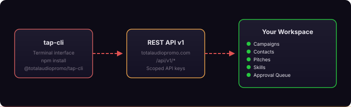

<p align="center">
  <a href="https://totalaudiopromo.com">
    
  </a>
</p>

<h1 align="center">tap-cli</h1>

<p align="center">
  <b>Terminal interface for <a href="https://totalaudiopromo.com">Total Audio Platform</a></b>
  <br>
  Manage campaigns, contacts, and pitches without leaving the command line.
</p>

<p align="center">
  <a href="https://www.npmjs.com/package/@totalaudiopromo/tap-cli">
    
  </a>
  <a href="https://www.npmjs.com/package/@totalaudiopromo/tap-cli">
    
  </a>
  <a href="LICENSE">
    
  </a>
  <a href="https://nodejs.org">
    
  </a>
  
</p>

<br>

<p align="center">
  
</p>

<br>

---

## Table of Contents

- [Features](#features)
- [Install](#install)
- [Quick start](#quick-start)
- [Architecture](#architecture)
- [Commands](#commands)
- [Global flags](#global-flags)
- [Configuration](#configuration)
- [Requirements](#requirements)
- [Sibling tools](#sibling-tools)
- [License](#license)

---

## Features

| | Feature | Description |
|---|---|---|
| 🚀 | **Campaign management** | Create, list, filter, and update campaigns from the terminal |
| 👤 | **Contact management** | Search, add, enrich, and import contacts with deduplication |
| ✍️ | **AI pitch drafting** | TAP drafts pitch variants per contact and saves them for your review |
| 📬 | **Approve from your phone** | Ask for approval from the terminal, approve in TAP on your phone, and see each pitch's result back in the terminal |
| 📋 | **Action queue** | See what needs you today: follow-ups, replies, stalled campaigns, coverage to log |
| 🧠 | **Skills** | List, run, fork, and inspect workspace skills from the terminal |
| 🔐 | **Scoped keys** | Same `tap_ak_*` keys as the REST API and MCP server |

---

## Install

```bash
npm install -g @totalaudiopromo/tap-cli
# or
pnpm add -g @totalaudiopromo/tap-cli
```

The binary is `tap`. Run `tap --version` to confirm it installed.

---

## Quick start

1. **Create a key** — sign in to [totalaudiopromo.com](https://totalaudiopromo.com), go to
   Settings → API Keys, and mint a scoped key (`tap_ak_...`).
2. **Log in** — `tap auth login` offers to open the API keys page, then verifies the key
   against TAP before saving it:

   ```bash
   npx @totalaudiopromo/tap-cli auth login
   ```

3. **Connect your agent** — wire the same key into Claude Code, Claude Desktop, or Cursor:

   ```bash
   tap mcp setup
   ```

From there:

```bash
# Open interactive mode
tap

# Or run commands directly
tap campaigns list --status active
tap stats
tap queue

# Check your setup any time
tap doctor
```

Interactive mode presents a menu-driven interface for all commands — useful when you don't know a specific ID or want to browse before acting.

---

## Architecture

<p align="center">
  
</p>

`tap-cli` proxies every call through `https://totalaudiopromo.com/api/v1/*`. Your scoped API key is the only credential you need — no Supabase keys, no direct database access. The same key works with the [MCP server](https://www.npmjs.com/package/@totalaudiopromo/tap-mcp) and the REST API.

---

## Commands

### `tap` — interactive mode

Run `tap` with no arguments to open the interactive menu. Navigate campaigns and contacts, generate pitches, log outcomes, and run any command without needing to know IDs up front.

```bash
tap
```

---

### `tap auth` — authentication

```bash
tap auth login              # default flow — asks for a tap_ak_* key
tap auth status             # show the key in use and where it came from (TAP_API_KEY or ~/.tap/config.json)
```

`tap auth login` offers to open the Settings → API Keys page in your browser, then verifies
the pasted key against TAP with a cheap read call before saving — a bad format, a 401, or a
network failure all get a clear message instead of a silently broken config.

Credentials are stored at `~/.tap/config.json` (chmod 600). The CLI proxies every call through the TAP REST API — no Supabase credentials touch your machine.

---

### `tap mcp setup` / `tap connect` — wire up an MCP client

Prints (or, with `--write`, writes) MCP server config for Claude Code, Claude Desktop, and
Cursor using the key already stored by `tap auth login`. The full key is never printed to
stdout — only inside a config file you've confirmed writing.

```bash
tap mcp setup                            # print config for all three targets
tap mcp setup --target claude-code       # just the claude mcp add command
tap mcp setup --target claude-desktop --write   # merge into claude_desktop_config.json
tap connect                              # shorthand for `tap mcp setup`
```

Claude Desktop and Cursor configs are merged, not overwritten — other registered servers are
left in place, and an existing file is backed up to `<path>.bak-<timestamp>` before any write.
For Claude Code, pass `--write` to have `tap` run `claude mcp add` for you (only if `claude` is
on PATH and you confirm), or use the printed remote alternative:

```bash
claude mcp add --transport http tap https://totalaudiopromo.com/api/mcp
```

---

### `tap doctor` — check your setup

```bash
tap doctor
tap doctor --json
```

Green/red checklist: Node version, a stored API key, whether TAP accepts that key, and
whether `@totalaudiopromo/tap-mcp` resolves on npm. Exits non-zero if anything's red.

---

### `tap campaigns` — manage campaigns

```bash
tap campaigns list                                        # list all campaigns
tap campaigns list --status active                        # filter by status
tap campaigns list --json                                 # JSON output

tap campaigns show <id>                                   # campaign detail with health metrics, funnel, coverage
tap campaigns show <id> --json

tap campaigns create -n "Q2 Radio Push" -a "Artist Name"
tap campaigns create -n "Release" -a "Artist" -r "EP Title" -d 2026-04-01 -c radio,press

tap campaigns status <id> active                          # change status
tap campaigns status <id> completed
```

**Status values:** `draft`, `active`, `paused`, `completed`, `archived`

**`campaigns create` flags:**

| Flag | Description |
|------|-------------|
| `-n, --name` | Campaign name (required) |
| `-a, --artist` | Artist name |
| `-r, --release` | Release name |
| `-d, --date` | Release date (YYYY-MM-DD) |
| `-c, --channels` | Channels, comma-separated: `radio,press,playlist` |

---

### `tap contacts` — manage contacts

```bash
tap contacts list                              # newest 50 contacts
tap contacts list --platform radio             # one platform type
tap contacts list -l 200 --page 2              # paginate (up to 200 per page)
tap contacts list --json

tap contacts show <id-or-email>               # full contact detail: relationship metrics, campaigns, intelligence
tap contacts show <id-or-email> --json

tap contacts history <id-or-email>            # cross-campaign timeline
tap contacts history <id-or-email> -l 100     # up to 100 events

tap contacts search "Radio 1"                 # search by name, email or outlet
tap contacts search "Radio 1" --json

tap contacts add -n "Name" -e "email@outlet.com"
tap contacts add -n "Name" -e "email@outlet.com" -o "BBC Radio 6 Music" -r presenter -g "Indie,Alternative" -p radio

tap contacts enrich <id>                      # queue contact for AI enrichment
```

**`contacts list` flags:**

| Flag | Description |
|------|-------------|
| `--platform` | Platform type: `radio`, `press`, `playlist`, `podcast`, `blog` |
| `-l, --limit` | Results per page, up to 200 (default: 50) |
| `-p, --page` | Page number (default: 1) |

These are the filters `GET /api/v1/contacts` supports. It returns name, email, outlet, role,
platform type and enrichment state, so the list shows those.

**`contacts add` flags:**

| Flag | Description |
|------|-------------|
| `-n, --name` | Contact name (required) |
| `-e, --email` | Email address (required) |
| `-o, --outlet` | Outlet, publication, or station |
| `-r, --role` | Role: `presenter`, `producer`, `journalist`, `playlist_curator` |
| `-g, --genre` | Genres, comma-separated |
| `-p, --platform` | Platform type: `radio`, `press`, `playlist`, `podcast`, `blog` |

---

### `tap pitch` — generate AI pitch drafts

Asks TAP to draft pitch variants for one contact in a campaign. TAP saves the draft for review. It never sends.

```bash
tap pitch <campaign-id>                                  # interactive contact selection
tap pitch <campaign-id> <contact-id>                     # specific contact
tap pitch <campaign-id> <contact-id> --tone casual
tap pitch <campaign-id> <contact-id> --json
```

**Flags:**

| Flag | Description |
|------|-------------|
| `--tone` | Tone: `professional` (default), `casual`, `enthusiastic` |
| `--dry-run` | Say what would be generated without generating |

---

### `tap approve` — ask for approval, answer in TAP

`tap approve` asks a person signed in to TAP to approve a campaign's pitches. It lists the pitches waiting for approval, lets you choose them, and prints a four-character code, the approve link and a QR code of the link. You open the link on your phone or computer, check that the page shows the same code, and approve there. The CLI waits, then shows which pitches were approved and why any were skipped.

The CLI never approves or sends. Its API key can create a request, read the answer and withdraw the request. Only a person signed in to TAP in a browser can answer it.

```bash
tap approve <campaign-id>                          # choose pitches, ask, wait
tap approve <campaign-id> --all                    # every pitch waiting for approval
tap approve <campaign-id> --pitch <id> --pitch <id>
tap approve <campaign-id> --all --no-wait --json   # for agents: return the request at once
tap approve status <request-id> --wait --json      # then wait for the answer
```

While it waits, `o` opens the link on this computer and `c` or Ctrl+C withdraws the request. A request expires after 15 minutes. If nothing waits for approval but the campaign has drafts, `tap approve` offers to queue them for review first. Queueing approves nothing.

In the chooser, space chooses a pitch, `a` chooses all or none, `r` shows the whole pitch, and enter asks.

**Flags:**

| Flag | Description |
|------|-------------|
| `--all` | Ask about every pitch waiting for approval (up to 50) |
| `--pitch <id>` | Ask about this pitch. Repeat for more |
| `--no-wait` | Return once the request exists. Check it with `tap approve status <request-id>` |
| `--json` | Print the request, or the answer with a per-pitch summary, as JSON |

`tap approve` exits 1 when the request ends with nothing approved (declined, expired, withdrawn or replaced by a newer request), and 0 otherwise.

---

### `tap send` — see what waits for your approval

Approving and sending a pitch happen in TAP, by you. `tap send` lists every one of the campaign's pitches that still needs you: drafts, pitches waiting for approval, approved pitches TAP has not sent yet, and approved pitches whose send failed or is held for payment. It then prints the link to the release's pitching tab where you approve and send them. To ask for approval from the terminal and approve on your phone, use `tap approve`.

```bash
tap send <campaign-id>
tap send <campaign-id> --open     # also open the link in your browser
tap send <campaign-id> --json
```

---

### `tap outcome` — log a campaign outcome

```bash
tap outcome <campaign-id> <contact-id> replied_positive
tap outcome <campaign-id> <contact-id> coverage --channel radio
tap outcome <campaign-id> <contact-id> replied_positive --notes "Loved it, wants exclusive"
tap outcome <campaign-id> <contact-id> declined --dry-run
```

**Outcome types:** `no_response`, `opened`, `replied_positive`, `replied_negative`, `added_to_playlist`, `interview_booked`, `coverage`, `declined`, `other`. The older words `replied`, `interested`, `played`, `covered`, `added` and `passed` still work and map to these.

**Flags:**

| Flag | Description |
|------|-------------|
| `-n, --notes` | Notes about the outcome |
| `-c, --channel` | Channel: `radio`, `press`, `playlist`, `sync` |
| `--dry-run` | Preview without saving |

TAP updates the contact's pitch status when the outcome is logged.

---

### `tap skill` — workspace skill management

Power-user terminal entry point for the same skill set Claude Code agents drive via the MCP server's `tap_list_skills` / `tap_get_skill` / `tap_run_skill` / `tap_fork_skill` / `tap_get_invocation` tools.

```bash
tap skill list                          # every skill visible to this workspace
tap skill list --json                   # JSON output

tap skill view draft-pitches            # manifest + resolved body
tap skill view radio-outreach --body-only

tap skill run fact-check --input '{"campaign_id":"abc"}'
tap skill run draft-pitches --input-file ./inputs/pitches.json
tap skill run voice-check --input '{...}' --json

tap skill edit draft-pitches            # opens $EDITOR on the body, saves as workspace fork
tap skill reset draft-pitches           # drops the workspace fork, restores TAP default

tap skill invocation <invocation-id>    # audit row inspector
```

`tap skill` is REST-only. It does not fall through to any legacy path.

---

### `tap queue` — daily action queue

Shows TAP's action list, the same one as your Home page: follow-ups due, unread replies, stalled campaigns, contacts going cold and coverage to log.

```bash
tap queue
tap queue --json
```

---

### `tap stats` and `tap discover` — open in TAP

The TAP API has no endpoint for workspace statistics or contact discovery yet. Both commands print the TAP page that has them: your Home page for stats, the contacts page for discovery.

```bash
tap stats
tap discover
```

---

### `tap import`: contacts from sink, CSV or JSON

Reads a CSV, JSON or JSONL file, or stdin when you pass `-`. It understands
[sink](https://www.npmjs.com/package/datasink) output directly, in every format `sink` writes:
the `--json` envelope from `sink wash`, and `--format json`, `jsonl` or `csv` files from
`sink wash`, `sink scrub` or `sink drain`. It uses sink's corrected email, skips rows sink
marked as duplicates or invalid, and sends up to 500 contacts per request.

```bash
# clean with sink, then import in one pipe (piping needs --yes)
sink wash contacts.csv --json -q | tap import - --yes

# no global install: run sink through npx
npx -y datasink wash contacts.csv --json -q | tap import - --yes

# or keep sink's file and import it later
sink wash contacts.csv --format json -o washed.json
tap import washed.json --campaign <campaign-id>

# run sink wash for you, when sink is on your PATH
tap import contacts.csv --wash

tap import contacts.csv --dry-run                  # parse and count without calling TAP
```

TAP stores email, name, outlet, role, platform type, genres, geographic scope and notes. Other
columns and sink's other enrichment (phone, website, best timing, pitch tips, steep's socials
and portals) are not stored, and `tap import` names them once so you know they stay in your file.

**Flags:**

| Flag | Description |
|------|-------------|
| `-` or `--stdin` | Read from stdin |
| `--wash` | Run `sink wash` on the file first (needs `sink` on your PATH: `npm i -g datasink`) |
| `--yes` | Skip confirmation (required when piping) |
| `--dry-run` | Parse and count without calling TAP |
| `--campaign <id>` | Add every contact in the file to this campaign, including ones already in TAP |
| `--json` | Counts as JSON |

---

### `tap watch` — follow a campaign in TAP

The TAP API has no activity feed yet, so `tap watch` prints the TAP page to follow instead: the release's Results tab, or your releases list.

```bash
tap watch                           # releases list
tap watch <campaign-id>             # that release's Results tab
```

---

### `tap open` — open TAP in the browser

Resolves an ID to the correct TAP page (contact or campaign) and opens it in your default browser. Supports truncated IDs.

```bash
tap open                    # open TAP home
tap open <id>               # auto-detect and open contact or campaign page
tap open <id> --url         # print URL only, do not open browser
```

---

## Global flags

All commands accept these flags:

| Flag | Description |
|------|-------------|
| `--json` | Output as JSON (most commands) |
| `-v, --version` | Print version |

---

## Configuration

Credentials are stored at `~/.tap/config.json` (automatically created by `tap auth login`):

```json
{
  "apiKey": "tap_ak_...",
  "tapUrl": "https://totalaudiopromo.com"
}
```

Your key decides the workspace. Older config files with `supabaseUrl` or `supabaseKey` are ignored, and `tap auth login` rewrites the file without them.

Environment variables override config file values:

| Variable | Description |
|----------|-------------|
| `TAP_API_KEY` | Your scoped API key (overrides config) |
| `TAP_URL` | TAP base URL (default: `https://totalaudiopromo.com`) |

---

## Requirements

- **Node.js 20** or later
- A **TAP account** on the year plan, the only plan with API access (see [totalaudiopromo.com](https://totalaudiopromo.com))
- A **scoped API key** from Settings → API Keys inside your workspace

---

## Sibling tools

| Tool | Description |
|------|-------------|
| [**MCP server**](https://www.npmjs.com/package/@totalaudiopromo/tap-mcp) | `npx -y @totalaudiopromo/tap-mcp@latest` — same `tap_ak_*` key, same REST proxying. Use this for Claude Code / Cursor / Hermes integrations. |
| [**sink-cli**](https://github.com/totalaudiopromo/sink-cli) | Contact discovery + signals layer. The vision: `sink discover ... | sink signals ... | tap import` as one pipeline. |

---

## License

MIT — see [LICENSE](LICENSE).

---

<p align="center">
  <a href="https://totalaudiopromo.com">totalaudiopromo.com</a> ·
  <a href="https://github.com/chrisschouk/tap-cli">GitHub</a> ·
  <a href="https://www.npmjs.com/package/@totalaudiopromo/tap-cli">npm</a>
</p>